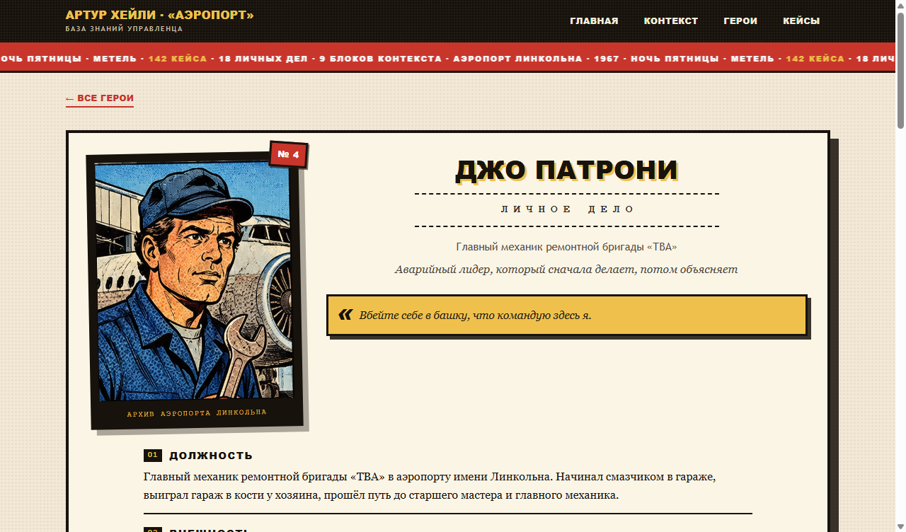

# Артур Хейли · «Аэропорт» — управленческий детектив

Одностраничный сайт для книжного клуба управленцев по роману Артура Хейли «Аэропорт» (1968). Читатель — **инспектор комиссии**, назначенной советом директоров аэропорта и городскими властями: нужно разобрать инцидент в метельную пятницу и оценить качество управленческих решений действующих лиц и меру их ответственности.

В материалах дела: **142 эпизода**, **18 личных дел** и **9 блоков контекста 1950–1973**. Оформление — комикс 70-х: газетный растр, жирные контуры, жёлтые плашки.

Всё собрано в один файл `index.html`: работает офлайн, без сервера, сборщиков и внешних библиотек.


## Быстрый старт

- **Просто открыть:** скачайте репозиторий и откройте `index.html` в браузере.
- **GitHub Pages:** сайт уже подготовлен к публикации — `index.html` в корне, `.nojekyll` отключает Jekyll. Пошаговая инструкция ниже.

### Публикация на GitHub

1. Создайте на GitHub пустой репозиторий `aeroport-book-club` — без README, лицензии и `.gitignore`, чтобы не было конфликтов.
2. В папке проекта выполните:

```bash
git init
git add .
git commit -m "Аэропорт: база знаний книжного клуба"
git branch -M main
git remote add origin https://github.com/<логин>/aeroport-book-club.git
git push -u origin main
```

3. В репозитории откройте **Settings → Pages**, в **Source** выберите **Deploy from a branch**, ветку `main` и папку `/ (root)`, нажмите **Save**.
4. Через 1–2 минуты сайт откроется по адресу `https://<логин>.github.io/aeroport-book-club/`.

Если `git` ещё не настроен, перед первым коммитом укажите имя и почту:

```bash
git config --global user.name "Ваше имя"
git config --global user.email "you@example.com"
```

Без команд: **GitHub Desktop → Add local repository → Publish repository**.

## Роль читателя

Вы — инспектор комиссии, назначенной советом директоров аэропорта и городскими властями. Задача — разобрать ночь пятницы: изучить контекст, прочитать личные дела участников, пройти по эпизодам и вынести оценку: насколько решения были обоснованы и где проходит граница личной ответственности. Сайт устроен как папка с материалами дела, порядок работы задан на главной.

## Что внутри

| Раздел | Содержание |
|---|---|
| **Контекст** | 9 блоков об отрасли: реактивная эра, джамбо и сверхзвук, рынок и тарифы, аэропорты, угоны, взрывы ради страховки, «зайцы», очереди, прогнозы |
| **Участники** | 18 личных дел: должность, внешность, образование, полномочия, компетенции, личная жизнь, связи, управленческий профиль, «чего нет в тексте» |
| **Эпизоды** | 142 эпизода по 15 направлениям проверки: что произошло, дословная цитата, вывод, вопрос комиссии |

Перекрёстная навигация: **участник → эпизод → контекст** и обратно. Есть поиск по участникам и эпизодам, фильтр по направлению проверки.

| Участники | Личное дело |
|---|---|
|  |  |

Мобильный вид — [отдельный скриншот](docs/preview/home-mobile.png); сайт адаптирован под 390 px.

## Структура репозитория

```
.
├─ index.html                 готовый сайт (один файл, офлайн)
├─ .nojekyll                  отключает Jekyll на GitHub Pages
├─ .gitignore                 исключает сборку и проверочные скриншоты
├─ docs/
│  ├─ aeroport-knizhny-klub.docx    методичка клуба: 8 встреч, 142 карточки
│  ├─ aeroport-geroi.docx           карточки 18 героев
│  ├─ aeroport-spravka-1960s.docx   отраслевая справка с источниками
│  └─ preview/                      скриншоты для README
└─ src/
   ├─ assets/
   │  ├─ cover-airport-70s.jpg      обложка главной
   │  └─ heroes/                    18 карточек участников, JPEG 520×780
   ├─ geroi.js                      18 личных дел
   ├─ cards.json                    142 эпизода
   ├─ kbase-context.js              9 блоков контекста
   ├─ styles.css                    оформление
   ├─ kbase-build-data.js           сборка kbase-data.json
   ├─ kbase-generate.js             генерация index.html
   ├─ actions.json                  сценарий браузерной проверки
   └─ tools/prep-portraits.ps1      подготовка карточек
```

`src/kbase-data.json` и `.office-verify/` — локальные артефакты сборки и проверки, в git не попадают.

## Сборка

Нужен Node.js 18+ (зависимостей нет).

```bash
npm run build
```

или по шагам:

```bash
node src/kbase-build-data.js   # geroi.js + cards.json + kbase-context.js → src/kbase-data.json
node src/kbase-generate.js     # src/kbase-data.json + styles.css + assets/ → index.html
```

Стили читаются из `src/styles.css` во время сборки — править нужно только этот файл и пересобирать.

## Данные

### Эпизод (кейс) — `src/cards.json`

```json
{
  "title": "С-01. Пульт, где решают, куда ехать снегоочистителям",
  "where": "Диспетчерская",
  "theme": "Оперативный штаб",
  "what": "…",
  "quote": "…",
  "lesson": "…",
  "question": "…"
}
```

- `id` извлекается из `title` (`С-01`…`С-142`), поэтому нумерация в заголовке обязательна;
- `theme` — `«Направление»` или `«Направление (доп.: Второе, Третье)»`.

### Лицо дела — `src/geroi.js`

Поля: `num`, `name`, `role`, `tagline`, `appearance`, `demo`, `position`, `education`, `powers`, `strong`, `weak`, `personal`, `relations`, `profile`, `unknown`, `quote`, `cases[]`.

URL-слаг задаётся картой в `src/kbase-build-data.js` (`slug()`), чтобы ссылки не зависели от кириллицы.

После правки данных достаточно пересобрать проект — `index.html` обновится.

## Карточки участников

В репозитории лежат готовые карточки JPEG 520×780 в `src/assets/heroes/`. Исходные PNG 800×1200 в репозиторий не входят.

`src/tools/prep-portraits.ps1` сжимает карточки целиком и раскладывает файлы по слагам. На странице личного дела нижняя подпись карточки обрезается средствами CSS, поэтому в файлах она сохраняется:

```powershell
$env:HERO_SRC = "путь\к\карточкам\800x1200"
powershell -NoProfile -ExecutionPolicy Bypass -File src\tools\prep-portraits.ps1
```

## Word-материалы

В `docs/` — три документа для встреч клуба: методичка с программой восьми встреч и 142 карточками, карточки героев и отраслевая справка 1960-х со списком источников.

## Проверка

Если установлен MultiTool, страницу можно прогнать в изолированном браузере:

```bash
multitool-node --skill websites verify.cjs index.html --actions src/actions.json
```

Проверяются вид на 1440 и 390 px, ошибки консоли, переполнение, битые изображения и цепочка переходов «дело → участники → личное дело → эпизоды».

## Авторство

Автор идеи — Чистяков Филипп (@phichi84).

## Права

Код — MIT (см. `LICENSE`). Текст романа, имена и характеры персонажей принадлежат правообладателям: цитаты — короткие фрагменты для учебного разбора. Подробнее — `NOTICE.md`.
